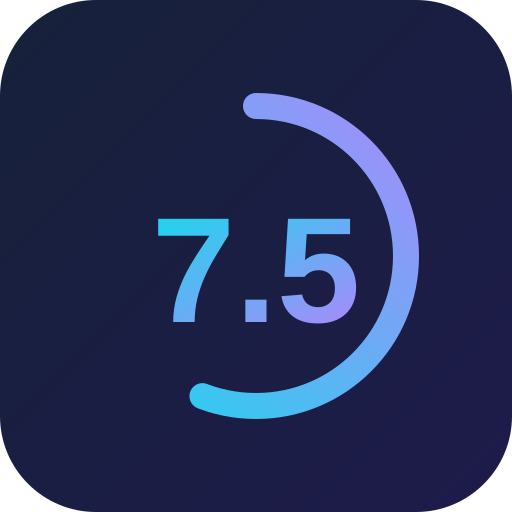

# IELTS 7.5 トレーニング基地（IELTS 7.5 リスニング・スピーキング練習）

[English](README.md) | [简体中文](README.zh-CN.md) | **日本語**



**IELTS のリスニングとスピーキングを 7.5+ へ引き上げる**ための、ゲーミフィケーションされたオフライン対応トレーニングアプリと、それを生み出したオリジナルの教材ワークスペースです。プレーンな HTML/CSS/JS によるプログレッシブ Web アプリ（PWA）で、フレームワークもビルド工程もありません。

> **公開サイト：** https://duanbiao2000.github.io/ielts-75/
> **ステータス：** v1.0 リリース済み。月刊フル模試バンク（Mock Bank）は 2026-11 〜 2027-08 に毎月1巻ずつ順次公開中。

---

## リポジトリの中身

### 1. アプリ本体 —— `onboarding/`（デプロイ可能なプロダクト）

モバイルファーストの PWA「IELTS 7.5 トレーニング基地」。学習の循環全体をひとつのインタラクティブ体験にまとめています。

- **診断ファースト**——4科目診断（リスニング／スピーキング／リーディング／ライティング）で現在地を測定し、個別の強化ルートを生成します。
- **方法論コース**——体系立った11レッスン（`lessons/`）：7.5の評価基準、リンキング／弱化、Part 1/2/3 戦略、リスニング Section 1–4、言い換え予測、発音、模試直前対策。
- **シーンライブラリと演習**——Part 1 頻出話題16 × 3シナリオ、30の実践シーン対話（留学／移住・仕事／汎用／出張／職場…）、バリエーションとシャドーイング演習つき。
- **強化モジュール**——12の P0 優先モジュール（発音、流暢さ、言い換え、フィードバック追跡、文法、インプット計画、Part 2/3 コーパス、試験心理、スコア較正…）。
- **リファレンスカード**——52枚、3層構成（必見 → 推奨 → 挑戦）。
- **ゲーミフィケーション**——XP と10段階の称号、25個のバッジ（条件 DSL）、連続学習 + 途切れ補填チケット、6章のストーリーマップ「6.0から7.5への旅」、巻ごとの進捗記録。
- **月刊模試バンク（Mock Bank）**——2026-11 〜 2027-08 毎月1巻（全10巻）。各巻 **125問・150点**（リスニング40 + Part 1 40×1 + Part 2 キューカード5枚×6 + Part 3 40×1）。リスニングは全文スクリプト付き。バンド換算 `round(raw/150 × 9 × 2)/2`。現在 2026-11／2026-12／2027-01 の3巻がコミット済み。詳細は `docs/mock-bank-design.md`。
- **オフライン対応＆アクセシビリティ**——バージョン付き Service Worker（cache-first でシェルを事前キャッシュ）、キーボード操作、フォーカス管理、Escape の階層的閉じ方、コントラスト比 4.5+、セマンティックランドマーク。iOS/Android の録音は `MediaRecorder` + MIME 検出で互換。
- **ローカルファースト**——すべての進捗は `localStorage` に保存。JSON（完全バックアップ）または CSV（学習記録ログ、BOM 付き・RFC 4180 エスケープ）へワンクリックでエクスポート可能。アカウントもサーバーも計測タグもありません。

### 2. 教材ワークスペース（リポジトリ直下）

アプリ以前のオリジナル教材一式。方法論と素材の原典です。

| パス | 内容 |
| --- | --- |
| `MISSION.md` | このワークスペースが存在する唯一の理由：1〜2か月・スピーキングの弱点克服・1日2時間 |
| `plan.md` | 8週間プラン、1日の時間割テンプレート、退出基準 |
| `RESOURCES.md` | 信頼度の高いソース一覧（公式バンドディスクリプタ、BBC Learning English、Cambridge 過去問、Anki…） |
| `GLOSSARY.md` | 用語の取り決め（使用／非推奨） |
| `lessons/` | 11本の独立 HTML レッスン（0001–0011） |
| `materials/` | Part 1 頻出話題 × 3シナリオ、30シーンパック、参考カード、`mock/topic-matrix.json`（カバレッジマトリクス） |
| `modules/` | 12の強化モジュール |
| `learning-records/`、`rollout-materials/` | 学習記録、法人導入キット |
| `docs/` | 設計・モデルドキュメント（下記） |

### 3. まず読むべきドキュメント

- `docs/mock-bank-design.md`——月刊問題集の設計（150点満点／IELTS 9バンド換算、カバレッジマトリクス、リリース規律、バッチ履歴）
- `docs/data-model.md`——エクスポート形式、バッジ条件 DSL、XP／連続記録／ストーリーモデル、状態のバージョン移行
- `docs/release-v1.0.md`——v1.0 納品チェックリスト、検証証跡、既知の制約

---

## クイックスタート

ビルドツールは不要。静的ホスティングでそのまま動きます。

```bash
git clone https://github.com/duanbiao2000/ielts-75.git
cd ielts-75/onboarding
python3 -m http.server 8123
# ブラウザで http://localhost:8123 を開く
```

任意の静的サーバーで構いません。`file://` 直開きでも大半の機能は動きます。Service Worker は HTTP(S) 経由でのみ登録されます。

> 既存ユーザーへの注意：更新後は1〜2回の再読み込み（またはサイトデータの消去）が必要な場合があります。事前キャッシュ型の SW が、初回アクセスでは前バージョンを配信するためです。

---

## 開発ガイド

### ディレクトリ構成

```
onboarding/          デプロイ用アプリ（バニラ HTML/CSS/JS）
  index.html         シェル＋各オーバーレイのマウント点
  js/app.js          UI エンジン、模試エンジン（150点制）、状態管理、XP/バッジ
  js/training.js     方法論データの再エクスポート
  js/course.js       コース／モジュール内容
  js/practice-full.js  30シーン分の対話コーパス（遅延読み込み）
  js/mock-bank.js    自動生成物。手編集禁止（ソースは scripts/mock-bank.json）
  content/lessons/   自動生成物（scripts/gen_content_viewer.py）—— リーダー用レッスン複製（同源 iframe）
  sw.js              事前キャッシュ＋バージョン付きオフラインキャッシュ（リリース毎に CACHE を上げること！）
scripts/             データ生成と品質ゲート（下記参照）
  mock-parts/        巻ごとの素材（リスニング本文、Part 1–3）
  mock-bank.json     問題集の唯一のソースオブトゥルース
materials/、lessons/、modules/   教材コンテンツ
docs/                設計・リリースドキュメント
```

### 品質ゲート

```bash
python3 scripts/build_mock_bank.py   # mock-parts/ から mock-bank.json を組み立て
python3 scripts/gen_mock_bank.py     # onboarding/js/mock-bank.js を生成
node scripts/validate-data.js        # 構造ゲート（数量／schema／カバレッジ）
node scripts/audit-content.js        # 内容ゲート（キーワード ⊆ 参考答案、重複・リークなし）
node scripts/audit-coverage.js       # 話題カバレッジのアサーション
node scripts/test-paths.js           # E2E 経路アサーション
node scripts/compat-test.js          # Playwright クロスブラウザスモーク（Chromium/WebKit/Firefox + iPhone/Pixel）
```

`compat-test.js` には Playwright が必要です（例：`npm i -D playwright` 後に `NODE_PATH=…/node_modules node scripts/compat-test.js http://localhost:8123/`）。エンジン層のヘッドレス DOM テストは `scripts/_test_*.js` にあります（gitignore 済み）。

### リリース規律（重要）

1. コンテンツのバッチを入れるたびに **`onboarding/sw.js` の `CACHE` を上げること**——キャッシュは cache-first です。
2. デプロイ：`git subtree split --prefix=onboarding main -b gh-pages && git push origin gh-pages`。GitHub Pages は `gh-pages` のルートを配信します。
3. 月刊問題集は1巻＝1バッチ、逐巻の受け入れ確認後に次へ。10巻揃った時点で、カバレッジ約束（Part 1 74/74、Part 2 ≥45%）が強制されます。

CI は未設定です。ゲートはすべてローカルで実行します。

---

## データ・プライバシー・エクスポート

状態はすべてクライアント側（`localStorage`）に保存されます。模試履歴（巻ごとの {best, takes, lastAt}）、XP／バッジ／連続記録、学習記録ログを含みます。エクスポート／インポートで端末間の移行が可能。自分でデプロイしない限り、データが端末の外に出ることはありません。

## 既知の制約

- リスニング音声は提供せず、**スクリプト本文の読解**で代替しています。スピーキング採点はキーワードマッチ＋録音再生による自己確認で、音声認識（ASR）ではありません。
- 月刊問題集のカバレッジ目標（P1 74/74、P2 ≥45%）は10巻揃った時点で強制されます。
- v1.0 由来の `mockBest`（≤20点）は寛容に移行されます。新巻は常に150点制です。

## 参加とライセンス

リポジトリ所有者の個人プロジェクトです（AI 支援によりバッチ単位で制作）。現時点で LICENSE ファイルはありません——コードとコンテンツは all-rights-reserved として扱ってください。GitHub Issues でのフィードバックと提案を歓迎します。
