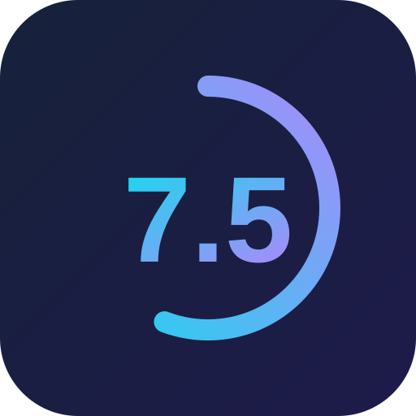

# IELTS 7.5 训练基地 (IELTS 7.5 Training Hub)

**English** | [简体中文](README.zh-CN.md) | [日本語](README.ja.md)



A gamified, offline-capable training app for boosting IELTS **Listening** and **Speaking** to **7.5+**, plus the original teaching workspace it grew out of. Built as a plain HTML/CSS/JS progressive web app — no framework, no build step.

> **Live site:** https://duanbiao2000.github.io/ielts-75/
> **Status:** v1.0 released; the monthly Full-Length Mock Bank is rolling out batch by batch (2026-11 → 2027-08).

---

## What's inside

### 1. The app — `onboarding/` (the deployable product)

A mobile-first PWA ("IELTS 7.5 训练基地") that wraps the whole course into one interactive experience:

- **Diagnosis first** — a 4-subject diagnostic (listening / speaking / reading / writing) sets your starting band and a personalized improvement route.
- **Methodology courses** — 11 structured lessons (`lessons/`) covering 7.5-band benchmarks, connected speech, Part 1/2/3 strategy, listening Section 1–4, paraphrase anticipation, pronunciation, and exam-sprint tactics.
- **Scene library & practice drills** — 30 real-life IELTS scenarios （留学/移民工作/通用/出行/职场…） with dialogues, variants, and guided shadowing practice.
- **Modules** — 12 P0-priority reinforcement modules (pronunciation, fluency, synonyms, feedback tracking, grammar, input plans, Part 2/3 banks, exam psychology, calibration…).
- **Reference cards** — 52 deep-dive cards in three layers （必看 → 推荐 → 挑战）.
- **Gamification** — XP & 10 levels, 25 badges (condition DSL), daily streaks with grace-tickets, a 6-chapter story map “从 6.0 到 7.5 的旅程”, and per-set progress.
- **Monthly Mock Bank （月刊模考）** — one full mock per month from 2026-11 to 2027-08 (10 volumes). Each volume: **125 questions, 150 raw points** (Listening 40 + Part 1 40×1 + Part 2 5 cue cards×6 + Part 3 40×1), Listening passages included, band conversion `round(raw/150 × 9 × 2)/2`. Three volumes (2026-11, 2026-12, 2027-01) are committed; see `docs/mock-bank-design.md`.
- **Offline & accessible** — versioned Service Worker (cache-first, precached shell), keyboard reachable, focus management, Escape layering, contrast ≥ 4.5, screen-reader landmarks; iOS/Android recording via `MediaRecorder` with MIME-type probing.
- **Deep links** — `#/read/lesson|scen|module/<id>[/<doc>]` opens the in-app reader directly (shareable), Back button returns to the calling popup; recent reads + weekly reading-time stats on the home screen.
- **Local-first data** — all progress lives in `localStorage`; one-click **export** to JSON (full backup) or CSV (learning-record log with BOM, RFC-4180 escaping). No account, no server, no tracking.

### 2. The teaching workspace (the repo root)

The course itself, authored before the app existed — kept as the source of truth for method and content:

| Path | Contents |
| --- | --- |
| `MISSION.md` | Why this workspace exists: 1–2 months, speaking weakness, daily 2h plan |
| `plan.md` | 8-week plan, daily-time template, exit criteria |
| `RESOURCES.md` | High-trust source library (official band descriptors, BBC LE, Cambridge, Anki…) |
| `GLOSSARY.md` | Banned/preferred terminology |
| `lessons/` | 11 standalone HTML lessons (0001–0011) |
| `materials/` | Topic banks (16 Part 1 topics × 3 scenarios), 30 scenario packs, reference cards, `mock/topic-matrix.json` (coverage matrix) |
| `modules/` | 12 reinforcement modules |
| `learning-records/`, `rollout-materials/` | Logs; company rollout kit |
| `docs/` | Design & model docs — see below |

### 3. Docs worth reading

- `docs/mock-bank-design.md` — Mock Bank design (150-point/9-band scheme, coverage matrix, release discipline, batch log)
- `docs/data-model.md` — export format, badge condition DSL, XP/streak/journey model, versioned state migration
- `docs/release-v1.0.md` — v1.0 delivery checklist, verification evidence, known limitations

---

## Quick start

No build tools required. Serve the static app:

```bash
git clone https://github.com/duanbiao2000/ielts-75.git
cd ielts-75/onboarding
python3 -m http.server 8123
# open http://localhost:8123
```

Any static web server works. Opening `index.html` via `file://` also mostly works; the Service Worker only registers over HTTP(S).

> Note for existing users: after an update you may need to refresh once or twice (or clear site data) — the precached Service Worker serves the previous version on first load.

---

## Development

### Repository layout

```
onboarding/          deployable app (vanilla HTML/CSS/JS)
  index.html         shell + overlay mount points
  js/app.js          UI engine, mock-bank engine (150 pts), state, XP/badges
  js/training.js     methodology data re-exports
  js/course.js       course/module content
  js/practice-full.js  30-scenario dialogues (lazy-loaded)
  js/mock-bank.js    GENERATED — do not edit (source: scripts/mock-bank.json)
  content/lessons/   GENERATED (scripts/gen_content_viewer.py) — lessons synced for the in-app reader
  content/modules/   GENERATED (scripts/gen_module_content.py) — module docs synced for the in-app reader
  sw.js              precached, versioned offline cache (bump CACHE per release!)
scripts/             data generators & quality gates (see below)
  mock-parts/        per-volume raw content (listening passages, P1–P3)
  mock-bank.json     single source of truth for the mock bank
materials/, lessons/, modules/   teaching content
docs/                design & release docs
```

### Quality gates

```bash
python3 scripts/build_mock_bank.py   # assemble mock-bank.json from mock-parts/
python3 scripts/gen_mock_bank.py     # generate onboarding/js/mock-bank.js
node scripts/validate-data.js        # structural gate (counts, schema, coverage)
node scripts/audit-content.js        # keyword ⊆ reference answers, no dup/leak
node scripts/audit-coverage.js       # topic coverage matrix assertions
node scripts/test-paths.js           # end-to-end path assertions
node scripts/compat-test.js          # Playwright cross-browser smoke (Chromium/WebKit/Firefox + iPhone/Pixel)
```

`compat-test.js` needs Playwright available (e.g. `npm i -D playwright` in a scratch dir, then `NODE_PATH=…/node_modules node scripts/compat-test.js http://localhost:8123/`). Headless DOM stubs for engine tests live in `scripts/_test_*.js` (gitignored).

### Release discipline (important)

1. Every content batch must **bump `CACHE` in `onboarding/sw.js`** — the cache is cache-first.
2. Deploy: `git subtree split --prefix=onboarding main -b gh-pages && git push origin gh-pages`; GitHub Pages serves `gh-pages` at the repo root. The site is live at the URL above.
3. Mock Bank batches ship one volume at a time; each batch is user-accepted before the next starts. Coverage targets (full version): **P1 74/74 topics, P2 ≥45%** — they are binding once 10 volumes exist.

No CI is configured; gates run locally.

---

## Data, privacy, export

All state is client-side (`localStorage`), including mock history ({best, takes, lastAt} per volume), XP/badges/streaks and the learning-record log. Export/import moves snapshots between devices; nothing leaves your machine unless you deploy it yourself.

## Known limitations

- Listening sections ship **passage text**, not audio; speech comparison relies on `MediaRecorder` playback and text-keyword scoring, not ASR.
- Monthly mock coverage targets (74/74 P1, ≥45% P2) apply to the completed 10-volume bank.
- The v1.0 `mockBest` legacy (≤20 pts) is migrated leniently; new volumes always use 150.

## Contributing / license

Personal project by the repo owner (built with AI assistance batch-by-batch). No license file is included yet — treat the code and content as all-rights-reserved. Issues and suggestions are welcome via GitHub.
