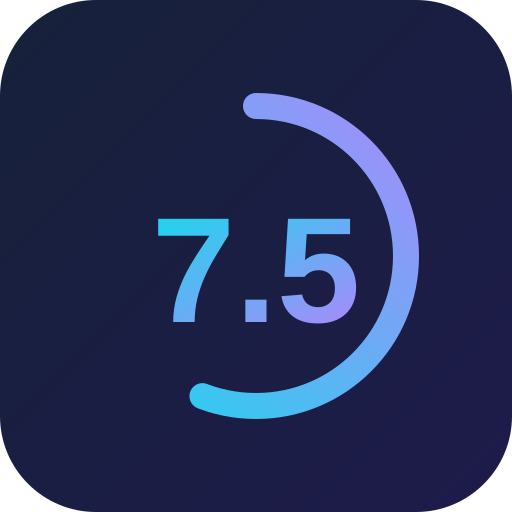

# IELTS 7.5 训练基地（雅思 7.5 听力·口语训练）

[English](README.md) | **简体中文** | [日本語](README.ja.md)



一个面向**雅思听力与口语冲刺 7.5+** 的游戏化、可离线使用的训练应用，外加培育它的原始教学工作区。纯 HTML/CSS/JS 渐进式 Web 应用（PWA）——无框架、无构建步骤。

> **线上地址：** https://duanbiao2000.github.io/ielts-75/
> **当前状态：** v1.0 已发布；月刊全真模考题库按批次滚动上线（2026-11 → 2027-08）。

---

## 仓库里有什么

### 1. 应用本体 —— `onboarding/`（可部署的产品）

移动端优先的 PWA「IELTS 7.5 训练基地」，把整条训练闭环做成一个交互式产品：

- **诊断先行**——四科诊断（听说读写）定位起点分数，生成个人化提升路线。
- **方法论课程**——11 节成体系课程（`lessons/`）：7.5 评分标准、连读弱读、Part 1/2/3 策略、听力 Section 1–4、同义替换预判、发音、模考冲刺。
- **场景库与演练**——16 个 Part 1 高频话题 × 3 大场景，30 个真实场景对话（留学/移民工作/通用/出行/职场…），含变体与跟读演练。
- **专项模块**——12 个 P0 优先强化模块（发音、流利度、同义替换、错题反馈、语法、输入计划、Part 2/3 语料、考场心态、分数校准…）。
- **参考卡**——52 张深读卡，三层递进（必看 → 推荐 → 挑战）。
- **游戏化**——XP 与 10 级称号、25 枚徽章（条件 DSL）、连续打卡 + 断签补偿券、六章剧情地图「从 6.0 到 7.5 的旅程」、分卷进度记录。
- **月刊模考题库（Mock Bank）**——2026-11 至 2027-08 每月一卷（共 10 卷）。每卷 **125 题、150 分**（听力 40 + Part 1 40×1 + Part 2 5 卡×6 + Part 3 40×1），听力均配完整原文；band 换算 `round(raw/150 × 9 × 2)/2`。目前已入库 2026-11、2026-12、2027-01 三卷，详见 `docs/mock-bank-design.md`。
- **离线可用 & 无障碍**——版本化 Service Worker（cache-first 预缓存外壳）、键盘可达、焦点管理、Escape 分级关闭、对比度 ≥ 4.5、语义化地标；iOS/Android 录音经 `MediaRecorder` + MIME 探测兼容。
- **本地优先**——所有进度存在 `localStorage`；一键导出 JSON（完整备份）或 CSV（学习记录流水，BOM、RFC-4180 转义）。无账号、无服务器、无埋点。

### 2. 教学工作区（仓库根目录）

应用之前的原始课程内容，仍是方法论与素材的真源：

| 路径 | 内容 |
| --- | --- |
| `MISSION.md` | 工作区存在的唯一理由：1–2 个月、口语短板、每天 2 小时 |
| `plan.md` | 8 周规划、每日时间模板、退出标准 |
| `RESOURCES.md` | 高信任度资源库（官方 band descriptors、BBC Learning English、剑桥真题、Anki…） |
| `GLOSSARY.md` | 术语约定（禁用词/推荐词） |
| `lessons/` | 11 节独立 HTML 课程（0001–0011） |
| `materials/` | Part 1 高频话题 × 3 大场景、30 个场景包、52 张参考卡、`mock/topic-matrix.json`（覆盖矩阵） |
| `modules/` | 12 个专项模块 |
| `learning-records/`、`rollout-materials/` | 学习记录；企业推广套件 |
| `docs/` | 设计与模型文档（见下） |

### 3. 值得先读的文档

- `docs/mock-bank-design.md`——月刊题库设计（满分 150/雅思 9 分制、覆盖矩阵、发布纪律、批次记录）
- `docs/data-model.md`——导出格式、徽章条件 DSL、XP/连续打卡/旅程模型、状态版本迁移
- `docs/release-v1.0.md`——v1.0 交付清单、验证证据、已知限制

---

## 快速开始

无需任何构建工具，静态托管即可：

```bash
git clone https://github.com/duanbiao2000/ielts-75.git
cd ielts-75/onboarding
python3 -m http.server 8123
# 浏览器打开 http://localhost:8123
```

任何静态服务器都行。`file://` 直接打开大部分功能可用；Service Worker 仅在 HTTP(S) 下注册。

> 老用户注意：更新后可能需要刷新一两次（或清一次站点数据）——预缓存型 SW 会先服务旧版本。

---

## 开发指南

### 目录结构

```
onboarding/          可部署应用（原生 HTML/CSS/JS）
  index.html         外壳 + 各覆盖层挂载点
  js/app.js          UI 引擎、模考引擎（150 分制）、状态、XP/徽章
  js/training.js     方法课数据再导出
  js/course.js       课程/模块内容
  js/practice-full.js  30 场景对话语料（懒加载）
  js/mock-bank.js    生成产物，禁止手改（数据源 scripts/mock-bank.json）
  sw.js              预缓存 + 版本化离线缓存（每次发布必须 bump CACHE！）
scripts/             数据生成与门禁脚本（见下）
  mock-parts/        每卷原始素材（听力原文、P1–P3）
  mock-bank.json     题库唯一数据源
materials/、lessons/、modules/   教学内容
docs/                设计与发布文档
```

### 质量门禁

```bash
python3 scripts/build_mock_bank.py   # 由 mock-parts/ 组装 mock-bank.json
python3 scripts/gen_mock_bank.py     # 生成 onboarding/js/mock-bank.js
node scripts/validate-data.js        # 结构门禁（数量/schema/覆盖率）
node scripts/audit-content.js        # 内容门禁（关键词⊆参考答案、无重复/泄露）
node scripts/audit-coverage.js       # 话题覆盖矩阵断言
node scripts/test-paths.js           # 端到端路径断言
node scripts/compat-test.js          # Playwright 跨引擎冒烟（Chromium/WebKit/Firefox + iPhone/Pixel）
```

`compat-test.js` 需要 Playwright（例如 `npm i -D playwright` 后 `NODE_PATH=…/node_modules node scripts/compat-test.js http://localhost:8123/`）。引擎级无头 DOM 测试见 `scripts/_test_*.js`（已 gitignore）。

### 发布纪律（重要）

1. 每次内容批次入库**必须 bump `onboarding/sw.js` 的 `CACHE`**——缓存是 cache-first。
2. 部署：`git subtree split --prefix=onboarding main -b gh-pages && git push origin gh-pages`；GitHub Pages 从 `gh-pages` 根目录托管。
3. 月刊题库一卷一批、逐卷验收再生成下一卷；10 卷齐后，覆盖承诺（P1 74/74、P2 ≥45%）强制生效。

仓库未配置 CI；门禁全部在本地跑。

---

## 数据、隐私、导出

全部状态保存在客户端（`localStorage`），包括模考历史（每卷 {best, takes, lastAt}）、XP/徽章/连续打卡与学习记录流水。导出/导入可在设备间迁移进度；除非你自己部署，数据不出本机。

## 已知限制

- 听力不提供音频，靠**原文阅读**替代；口语评分是关键词匹配 + 录音回放自查，非语音识别。
- 月刊题库覆盖目标（P1 74/74、P2 ≥45%）在 10 卷齐全后才强制断言。
- v1.0 遗留的 `mockBest`（≤20 分）做了宽容迁移；新卷一律 150 分制。

## 参与与许可

仓库所有者的个人项目（按批次由 AI 辅助生成）。尚未附带许可证——代码与内容按 all-rights-reserved 处理。欢迎通过 GitHub Issues 反馈与建议。
